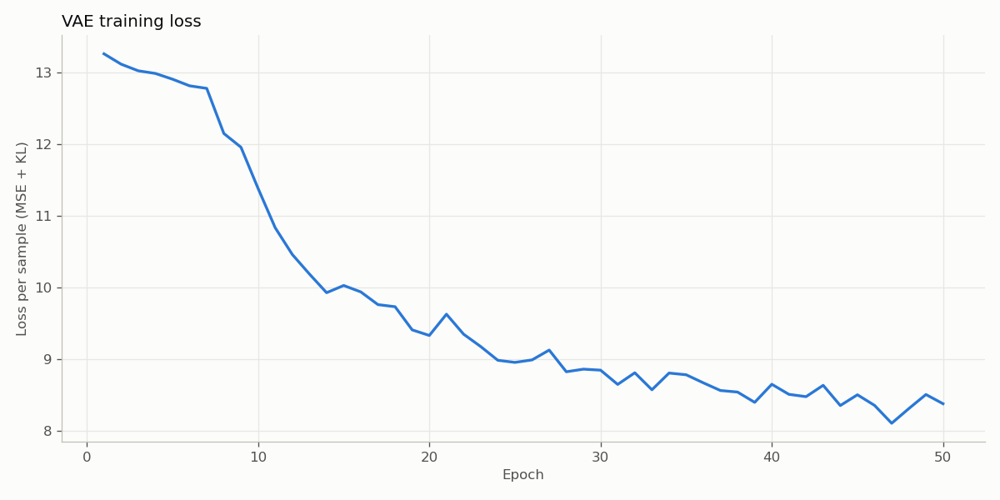
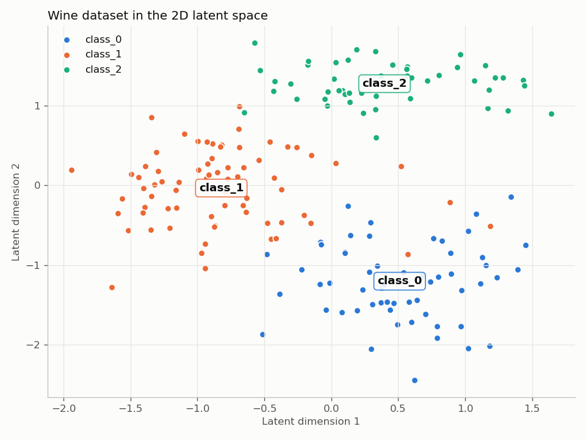
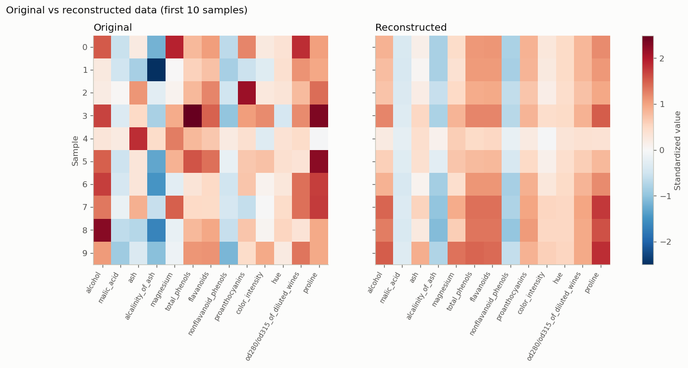

# Sprint17. Generative AI in Data Science

### Task 2: Data Compression and Reconstruction Using Variational Autoencoder (VAE) for Numerical Data

In this task, we are working with a **Variational Autoencoder (VAE)** to perform dimensionality reduction and data reconstruction on the **Wine dataset**. The goal is to take high-dimensional data, reduce it to a lower latent space, and then reconstruct the original data as accurately as possible from that lower-dimensional representation. This task is essential for understanding how generative models like VAEs can compress and generate new data.

### Task Breakdown:

1. **Dataset**: The **Wine dataset** from the `sklearn.datasets` module is used. It consists of 13 numerical features representing different chemical properties of wine. The data is first standardized (scaled) to ensure that each feature contributes equally during training.
   
2. **VAE Architecture**:
   - **Encoder**: This part of the model compresses the input data into a lower-dimensional latent space by generating two outputs:
     - `mean`: the mean of the latent space variables.
     - `log_var`: the logarithm of the variance for the latent space variables (used for reparameterization).
   - **Reparameterization**: The VAE uses the "reparameterization trick" to ensure the latent space variables are differentiable by introducing random noise based on the `mean` and `log_var`.
   - **Decoder**: The decoder takes the latent space representation and reconstructs the input data from this lower-dimensional representation.

3. **Loss Function**:
   - **Reconstruction Loss**: Measures the difference between the original data and the reconstructed data (using Mean Squared Error in this case).
   - **KL Divergence**: A regularization term that ensures the latent space follows a standard normal distribution.

4. **Training**: The model is trained for a specified number of epochs using an optimizer (Adam). During training, the model learns to minimize the combined reconstruction and KL divergence loss.


### Results

Run training (trains the VAE for 50 epochs and saves the plots to `docs/`):

```bash
pip install -r requirements.txt
python -m src.GAN_Task2
```

**Training loss** (reconstruction MSE + KL divergence per sample):



**Latent space**: the 13 features compressed to 2 dimensions (encoder mean), coloured by wine class. The three classes form separate clusters even though the labels are never used during training:



**Reconstruction**: original vs reconstructed standardized values for the first 10 samples. The decoder keeps the overall pattern of each sample but smooths out the extreme values, which is expected when compressing 13 features into 2:


